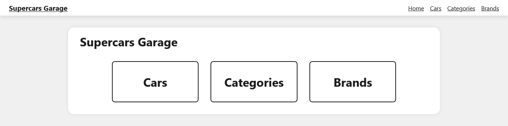
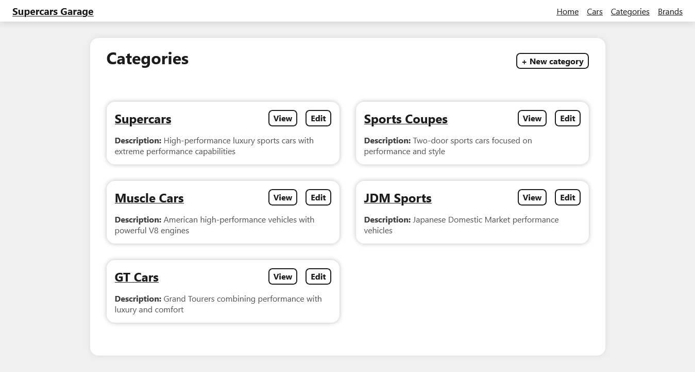
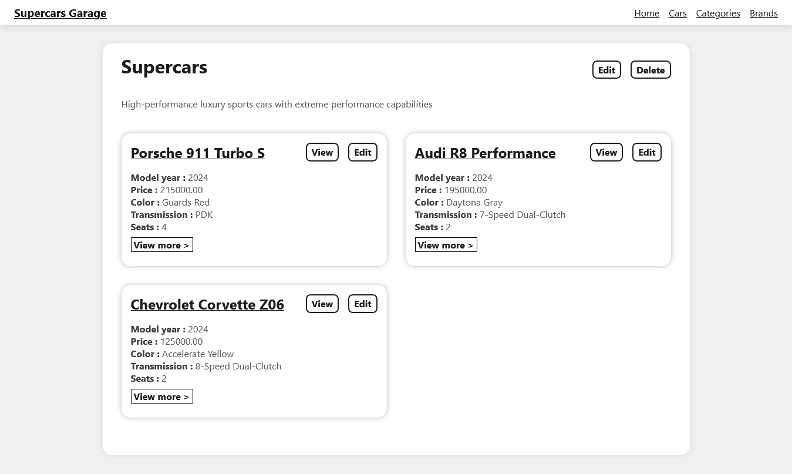
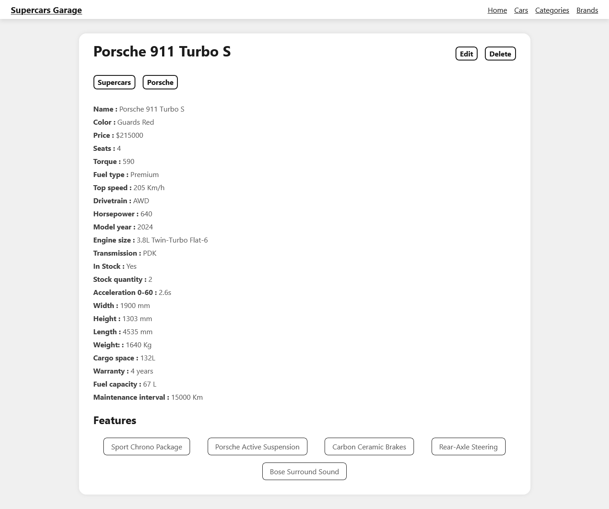
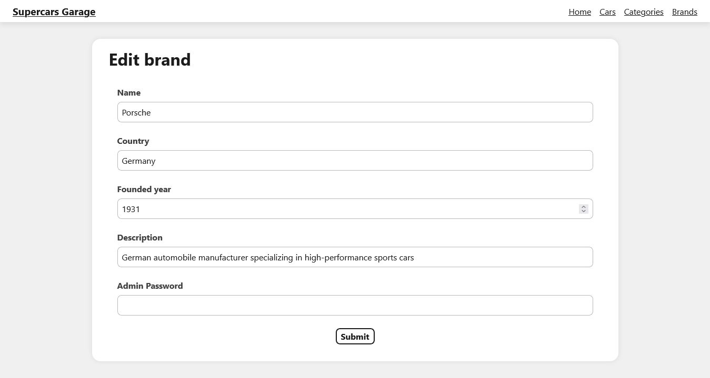

# Supercars Garage - Express.js Inventory Management System

A full-featured inventory management application for supercars, built with Express.js, PostgreSQL, and EJS. Demonstrates forms and data handling, validation, database integration, and deployment-ready architecture.

## Learning Objectives

This project was specifically designed to demonstrate and practice:

- **Deployment and PaaS** - Preparing applications for cloud deployment
- **Forms and Data Handling** - HTML forms, actions, methods, and data processing
- **Express Validator** - Validation and sanitization chaining
- **Form Design Best Practices** - Data integrity and user experience
- **PostgreSQL Integration** - Setting up databases with node-postgres
- **Database Population Scripts** - Seeding data with SQL scripts
- **Express Routes** - RESTful routing patterns
- **Query Building** - Parameterized queries with pg

## Live Demo

[View Live Demo](https://top-inventory-inventory-application.onrender.com/)
\*The free servers may take a few seconds to respond on first request.

## Screenshots







## Project Architecture

```

inventory-application/
├── app.js # Main Express application
├── controllers/ # Business logic layer
│   ├── brands.js # Brand CRUD operations
│   ├── cars.js # Car CRUD operations
│   ├── categories.js # Category CRUD operations
│   └── validators.js # Shared validation chains
├── routes/ # Route definitions
│   ├── brand.js # Brand routes
│   ├── car.js # Car routes
│   └── category.js # Category routes
├── db/ # Database layer
│   ├── pool.js # PostgreSQL connection pool
│   ├── queries.js # Shared query utilities
│   ├── brands.js # Brand queries
│   ├── cars.js # Car queries
│   ├── categories.js # Category queries
│   ├── car_specifications.js # Specs queries
│   ├── create_tables.js # Schema creation script
│   ├── drop_tables.js # Schema removal script
│   ├── populate.js # Data seeding script
│   └── connection_config.js # DB connection settings
├── views/ # EJS templates
│   ├── partials/ # Reusable template components
│   ├── brands.ejs # Brand listing
│   ├── brand.ejs # Brand details
│   ├── cars.ejs # Car listing
│   ├── car.ejs # Car details
│   ├── categories.ejs # Category listing
│   ├── category.ejs # Category details
│   └── delete.ejs # Confirmation page
├── public/ # Static assets
│   └── styles.css # Global styles
└── .env # Environment variables

```

## Forms and Data Handling

### HTML Form Structure

```ejs
<!-- views/cars_form.ejs - Complete car creation form -->
<form action="/cars/new" method="POST">
  <div class="form-row">
    <label for="name">Name</label>
    <input type="text" name="name" id="name" required />
  </div>
  <div class="form-row">
    <label for="category-id">Category</label>
    <select name="category-id" id="category-id" required>
      <% for(const category of categories) { %>
        <option value="<%= category.id %>">
          <%= category.name %>
        </option>
      <% } %>
    </select>
  </div>
  <!-- More form fields... -->
  <button type="submit">Submit</button>
</form>
```

### Form Methods and Actions

| Attribute | Purpose                 | Example                                |
| --------- | ----------------------- | -------------------------------------- |
| `action`  | Where to send form data | `/cars/new`, `/brands/edit/5`          |
| `method`  | HTTP verb (GET or POST) | `GET` (search), `POST` (create/update) |
| `enctype` | Encoding type           | `multipart/form-data` (file uploads)   |

### Nested Form Data (Arrays and Objects)

```ejs
<!-- Handling dynamic arrays of features -->
<div class="features-container">
  <input type="text" name="specs[features]" value="GPS Navigation">
  <input type="text" name="specs[features]" value="Heated Seats">
</div>

<!-- Nested object structure -->
<input type="hidden" name="specs[weight-kg]" value="1640">
<input type="hidden" name="specs[length-mm]" value="4535">
```

## Express Validator

### Creating Validation Chains

```javascript
// controllers/validators.js
const { body, param } = require("express-validator");

function createTextChain(field, maxLength = Number.MAX_SAFE_INTEGER) {
  const casedField = toCapitalized(field);
  return body(field)
    .trim() // Remove whitespace
    .isLength({ min: 1, max: maxLength }) // Validate length
    .withMessage(`${casedField} must be between 1 and ${maxLength} characters`);
}

function createIntChain(field, max = Number.MAX_SAFE_INTEGER) {
  const casedField = toCapitalized(field);
  return body(field)
    .isInt() // Must be integer
    .withMessage(`${casedField} must be an integer`)
    .isInt({ min: 0, max: max }) // Range validation
    .withMessage(`${casedField} must be between 0 and ${max}`);
}

function checkPassword() {
  return body("password").custom((value) => {
    if (value !== process.env.ADMINPASSWORD) {
      throw new Error("Invalid password");
    }
    return true;
  });
}
```

### Chaining Validations

```javascript
// controllers/brands.js - Validation chain for brand form
const validateBrand = [
  createTextChain("name", 100),
  createTextChain("country", 40),
  createIntChain("founded-year"),
  createTextChain("description"),
];

const brandFormPost = [
  checkPassword(), // First: verify admin access
  validateBrand, // Second: validate all fields
  async function brandFormPost(req, res) {
    const errors = validationResult(req);
    if (!errors.isEmpty()) {
      // Re-render form with errors
      res.locals.errors = errors.array();
      return brandFormGet(req, res);
    }
    // Save to database
  },
];
```

### Custom Parameter Validation

```javascript
// controllers/brands.js - Verify brand exists before proceeding
const brandExist = () =>
  param("id").custom(async (value, { req }) => {
    if (!Number.isInteger(parseInt(value))) {
      return;
    }

    const brand = await brandsDB.getBrandById(value);
    if (!brand) {
      throw new Error(`Brand with id ${value} doesn't exist`);
    }
    req.locals = { brand }; // Store for later use
  });

// Use in route handlers
const brandGet = [
  idParamIsInt(), // Validate ID is integer
  brandExist(), // Verify brand exists
  async function brandGet(req, res) {
    const brand = req.locals.brand; // Access pre-fetched brand
    res.render("brand", { brand });
  },
];
```

### Validation Results Handling

```javascript
// Displaying errors in EJS template
<% if (locals.errors) { %>
  <div class="errors">
    <h2>Error</h2>
    <% for(const error of errors) { %>
      <div class="error">- <%= error.msg %></div>
    <% } %>
  </div>
<% } %>

// Preserving form data after validation failure
res.locals.brand = {
  name: req.body.name,
  country: req.body.country,
  // ... preserve user input
};
```

## Admin Password Protection

```javascript
// controllers/validators.js
function checkPassword() {
  return body("password").custom((value) => {
    if (value !== process.env.ADMINPASSWORD) {
      throw new Error("Invalid password");
    }
    return true;
  });
}

// Applied to all write operations
const brandFormPost = [
  checkPassword(), // Must be first!
  validateBrand,
  async function brandFormPost(req, res) {
    // Only reaches here if password is correct
  },
];
```

## PostgreSQL with node-postgres

### Setting Up Connection Pool

```javascript
// db/connection_config.js
require("dotenv").config();

module.exports = {
  connectionString: `postgresql://${process.env.PGUSER}:${
    process.env.PGPASSWORD
  }@${process.env.PGHOST}${
    process.env.PGPORT ? ":" + process.env.PGPORT : ""
  }/${process.env.PGDATABASE}?${process.env.PGPARAMS}`,
};

// db/pool.js
const { Pool } = require("pg");
const connection_config = require("./connection_config");

module.exports = new Pool(connection_config);
```

### Query Utilities

```javascript
// db/queries.js - Reusable query functions
const pool = require("./pool");

async function runQuery(query, params = []) {
  try {
    return await pool.query(query, params);
  } catch (error) {
    console.error(error);
    throw error;
  }
}

async function runGetQuery(query, params = []) {
  try {
    const { rows } = await pool.query(query, params);
    return rows;
  } catch (error) {
    console.error(error);
    throw error;
  }
}
```

### CRUD Operations with PostgreSQL

```javascript
// db/brands.js - Brand database operations
async function createBrand({ name, country, founded_year, description }) {
  const query = `INSERT INTO brands (name, country, founded_year, description)
                 VALUES ($1, $2, $3, $4) RETURNING id;`;
  const params = [name, country, founded_year, description];

  const { rows } = await runQuery(query, params);
  return rows[0].id;
}

async function getAllBrands() {
  const query = "SELECT * FROM brands ORDER BY name;";
  return await runGetQuery(query);
}

async function getBrandById(id) {
  const query = "SELECT * FROM brands WHERE id = $1;";
  const params = [id];

  const brands = await runGetQuery(query, params);
  return brands[0];
}

async function updateBrand(id, { name, country, founded_year, description }) {
  const query = `UPDATE brands
                 SET name = $1, country = $2, founded_year = $3, description = $4
                 WHERE id = $5;`;
  const params = [name, country, founded_year, description, id];

  await runQuery(query, params);
}

async function deleteBrand(id) {
  const query = "DELETE FROM brands WHERE id = $1;";
  const params = [id];

  await runQuery(query, params);
}
```

### Complex Queries with JOINs and JSON

```javascript
// db/cars.js - Fetch car with related data using JSON aggregation
async function getCarDetailsById(id) {
  const query = `
    SELECT
      jsonb_build_object(
        'car', cars,
        'specs', specs,
        'category', categories,
        'brand', brands
      ) AS details
    FROM cars
    LEFT JOIN car_specifications AS specs ON cars.id = specs.car_id
    JOIN categories ON cars.category_id = categories.id
    JOIN brands ON cars.brand_id = brands.id
    WHERE cars.id = $1;
  `;
  const params = [id];

  const cars = await runGetQuery(query, params);
  return cars[0];
}
```

## Database Schema Scripts

### Creating Tables

```javascript
// db/create_tables.js
const SQL_CREATE_TABLES = `
CREATE TABLE IF NOT EXISTS categories (
  id INT PRIMARY KEY GENERATED ALWAYS AS IDENTITY,
  name VARCHAR(100) NOT NULL,
  description TEXT
);

CREATE TABLE IF NOT EXISTS brands (
  id INT PRIMARY KEY GENERATED ALWAYS AS IDENTITY,
  name VARCHAR(100) NOT NULL,
  country VARCHAR(40),
  founded_year INT,
  description TEXT
);

CREATE TABLE IF NOT EXISTS cars (
  id INT PRIMARY KEY GENERATED ALWAYS AS IDENTITY,
  category_id INT REFERENCES categories(id) ON DELETE CASCADE,
  brand_id INT REFERENCES brands(id) ON DELETE CASCADE,
  name VARCHAR(100) NOT NULL,
  model_year INT,
  price DECIMAL(10, 2),
  horsepower INT,
  torque INT,
  top_speed INT,
  acceleration_0_60 DECIMAL(4, 2),
  transmission VARCHAR(50),
  drivetrain VARCHAR(50),
  fuel_type VARCHAR(50),
  engine_size VARCHAR(50),
  seats INT,
  color VARCHAR(50),
  in_stock BOOLEAN DEFAULT true,
  stock_quantity INT DEFAULT 0
);

CREATE TABLE IF NOT EXISTS car_specifications (
  id INT PRIMARY KEY GENERATED ALWAYS AS IDENTITY,
  car_id INT REFERENCES cars(id) ON DELETE CASCADE,
  weight_kg INT,
  length_mm INT,
  width_mm INT,
  height_mm INT,
  fuel_capacity_l INT,
  cargo_space_l INT,
  warranty_years INT,
  maintenance_interval_km INT,
  features JSON
);
`;
```

### Dropping Tables (Cleanup)

```javascript
// db/drop_tables.js
const SQL_DROP_TABLES = `
DROP TABLE IF EXISTS car_specifications;
DROP TABLE IF EXISTS cars;
DROP TABLE IF EXISTS categories;
DROP TABLE IF EXISTS brands;
`;
```

### Populating Database with Seed Data

```javascript
// db/populate.js - Complete database setup script
async function main() {
  console.log("Initializing the database creation process");
  const client = new Client(config);
  console.log("Connecting to database...");
  await client.connect();

  console.log("Dropping existing data...");
  await client.query(SQL_DROP_TABLES);

  console.log("Creating tables...");
  await client.query(SQL_CREATE_TABLES);

  console.log("Inserting data...");
  await client.query(SQL_INSERT_DATA);

  await client.end();
  console.log("Done!");
}

// Run directly: node db/populate.js
if (require.main === module) {
  main();
}
```

## Express Routes Structure

### RESTful Route Patterns

| Resource       | List (GET)    | View (GET)             | Create (GET/POST) | Edit (GET/POST)        | Delete (GET/POST)        |
| -------------- | ------------- | ---------------------- | ----------------- | ---------------------- | ------------------------ |
| **Brands**     | `/brands`     | `/brands/view/:id`     | `/brands/new`     | `/brands/edit/:id`     | `/brands/delete/:id`     |
| **Cars**       | `/cars`       | `/cars/view/:id`       | `/cars/new`       | `/cars/edit/:id`       | `/cars/delete/:id`       |
| **Categories** | `/categories` | `/categories/view/:id` | `/categories/new` | `/categories/edit/:id` | `/categories/delete/:id` |

### Route Definitions

```javascript
// routes/brand.js
const { Router } = require("express");
const brandsController = require("../controllers/brands");

const brandRouter = Router();

// Listing routes
brandRouter.get("/", brandsController.brandsGet);

// Creation routes
brandRouter.get("/new", brandsController.brandFormGet);
brandRouter.post("/new", brandsController.brandFormPost);

// Read routes
brandRouter.get("/view/:id", brandsController.brandGet);

// Update routes
brandRouter.get("/edit/:id", brandsController.brandEdit);
// POST edit handled by same /new endpoint (checks for id in body)

// Delete routes
brandRouter.get("/delete/:id", brandsController.brandDeleteGet);
brandRouter.post("/delete/:id", brandsController.brandDeletePost);

module.exports = brandRouter;
```

### Mounting Routes in App

```javascript
// app.js
const carRouter = require("./routes/car");
const categoryRouter = require("./routes/category");
const brandRouter = require("./routes/brand");

app.use("/cars", carRouter);
app.use("/categories", categoryRouter);
app.use("/brands", brandRouter);
```

## Deployment and PaaS

### Environment Variables (.env)

```env
# .env - NEVER commit this file!
PORT=3000

# Database Configuration
PGUSER=your_database_user
PGPASSWORD=your_secure_password
PGHOST=your-db-host.com
PGPORT=5432
PGDATABASE=inventory_db
PGPARAMS=sslmode=require

# Application Security
ADMINPASSWORD=secure_admin_password
```

### Deployment Checklist

```bash
# 1. Set up production database (Railway/Render/Heroku PostgreSQL)
# 2. Configure environment variables on PaaS
# 3. Run database migrations
node db/create_tables.js
node db/populate.js

# 4. Start production server
npm start
```

### Platform-Specific Configuration

```javascript
// Railway.app, Render.com, Heroku automatically set PORT
const PORT = process.env.PORT || 3000;

// Heroku PostgreSQL add-on provides DATABASE_URL
const connectionString =
  process.env.DATABASE_URL || `postgresql://${process.env.PGUSER}...`;
```

## Form Design Best Practices

| Practice               | Implementation                           | Purpose           |
| ---------------------- | ---------------------------------------- | ----------------- |
| **Validation**         | express-validator chains                 | Data integrity    |
| **Error Display**      | Re-render with error messages            | User feedback     |
| **Value Preservation** | Populate fields with submitted data      | Prevent re-typing |
| **CSRF Protection**    | (Add csurf middleware)                   | Security          |
| **Rate Limiting**      | (Add express-rate-limit)                 | Prevent abuse     |
| **Input Sanitization** | `.trim()` on all text fields             | Security          |
| **Type Enforcement**   | `isInt()`, `isFloat()` on numeric fields | Data quality      |

## What I learned

### Forms and Data Handling

- **Form Methods** - `GET` for searches, `POST` for modifications
- **Action Attributes** - URL endpoint that processes the form
- **Nested Data** - Use bracket notation for arrays/objects (`specs[features]`)
- **Validation** - Always validate on server (never trust client)

### Express Validator

- **Validation Chains** - `.trim().isLength().withMessage()`
- **Custom Validators** - Database existence checks
- **Sanitization** - `.trim()`, `.escape()`, `.toInt()`
- **Error Collection** - `validationResult(req)` gathers all errors
- **Preserve Input** - Re-populate forms with `req.body` values

### PostgreSQL with node-postgres

- **Connection Pool** - Reusable connections, better performance
- **Parameterized Queries** - Use `$1`, `$2` to prevent SQL injection
- **RETURNING Clause** - Get auto-generated IDs after INSERT
- **ON DELETE CASCADE** - Automatically delete dependent records
- **JSON Aggregation** - Use `jsonb_build_object()` for nested responses

### Database Scripts

- **Migration Scripts** - `create_tables.js`, `alter_tables.js`
- **Seed Scripts** - `populate.js` for initial data
- **Rollback Scripts** - `drop_tables.js` for clean slate
- **Idempotency** - Use `IF NOT EXISTS`, `DROP IF EXISTS`

### Deployment

- **Environment Variables** - Never hardcode credentials
- **PaaS Configuration** - Set environment variables in dashboard
